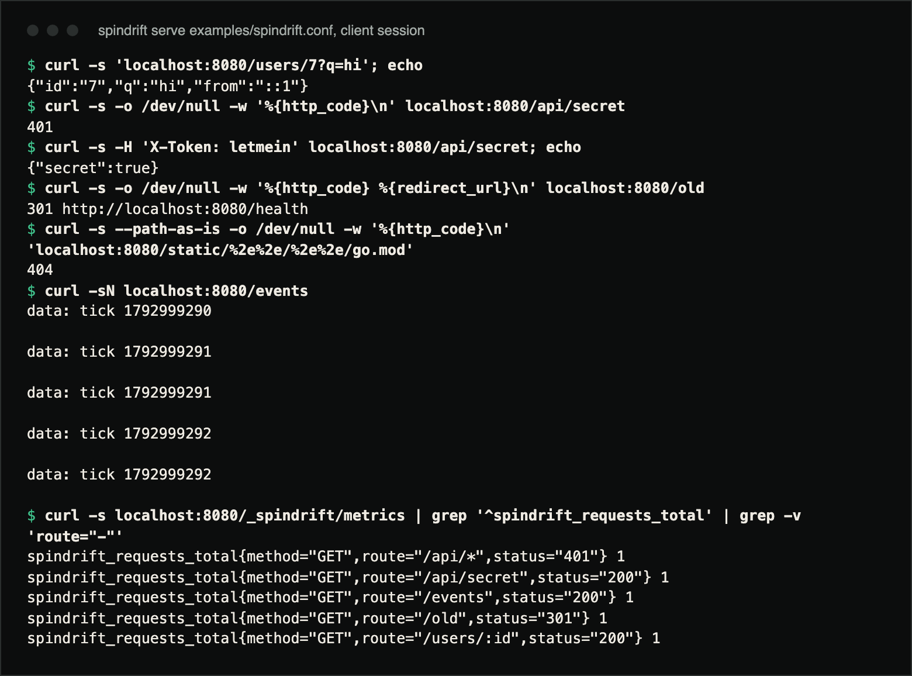
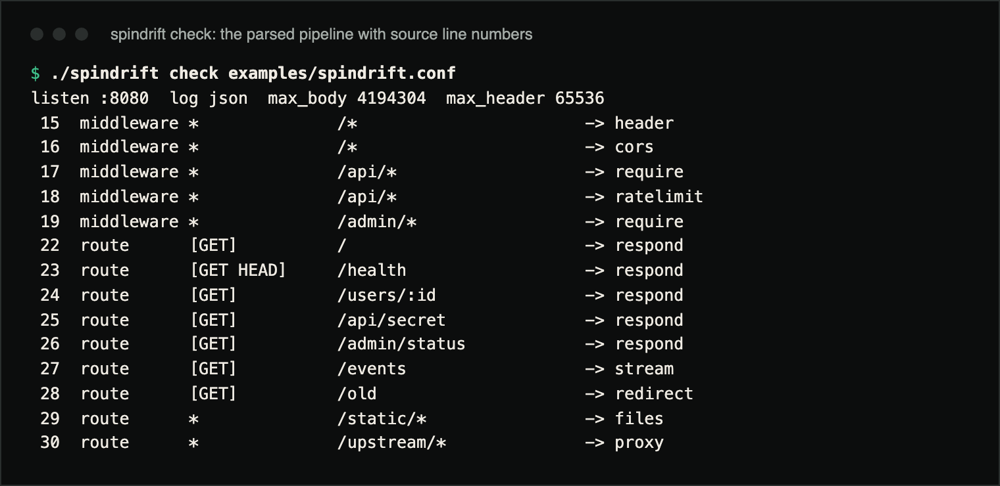

# Spindrift

A programmable HTTP/1.1 server with its own protocol stack, a small pipeline
language instead of a config file, and hot reloads that let in-flight requests
finish on the old pipeline.

[Case study ↗](https://hellpuff.dev/work/spindrift)

Spindrift is about 2,250 lines of Go (excluding tests) with no dependencies
outside the standard library, and it does not use `net/http` on the server
side. Requests are parsed by Spindrift's own strict RFC 9112 implementation,
then flow through a pipeline you write in a small declarative language:
middleware, routing, static files, reverse proxy, streaming, rate limits,
conditions and templates.

**Status:** unreleased (no tagged version yet). HTTP/1.1 only, no TLS; see
Limitations and [`ROADMAP.md`](ROADMAP.md).

A pipeline file looks like this (it passes `spindrift check`, which warns if
`API_TOKEN` is unset):

```
listen :8080
log json

middleware * /*        -> header "Server" "Spindrift"
middleware * /api/*    -> require header.X-Token exists && header.X-Token == env.API_TOKEN else 401
middleware * /api/*    -> ratelimit 20/s burst 40
route GET /health      -> respond 200 text "ok"
route GET /users/:id   -> respond 200 json "{\"id\":\"{{param.id}}\",\"q\":\"{{query.q}}\"}"
route GET /events      -> stream every 1s "tick {{unix}}" count 5
route * /static/*      -> files "./public"
route * /api/*         -> proxy "http://127.0.0.1:9000"
```

## Demo

Real terminal captures from a clone on macOS, Go 1.27.3, with
`./spindrift serve examples/spindrift.conf` running in another terminal. It
prints `spindrift listening on [::]:8080 (14 rules) — SIGHUP reloads, SIGINT drains`
on start, and access logs as JSON lines.



```console
$ curl -s 'localhost:8080/users/7?q=hi'; echo
{"id":"7","q":"hi","from":"::1"}
$ curl -s -o /dev/null -w '%{http_code}\n' localhost:8080/api/secret
401
$ curl -s -H 'X-Token: letmein' localhost:8080/api/secret; echo
{"secret":true}
$ curl -s -o /dev/null -w '%{http_code} %{redirect_url}\n' localhost:8080/old
301 http://localhost:8080/health
$ curl -s --path-as-is -o /dev/null -w '%{http_code}\n' 'localhost:8080/static/%2e%2e/%2e%2e/go.mod'
404
$ curl -sN localhost:8080/events
data: tick 1792999290

data: tick 1792999291

data: tick 1792999291

data: tick 1792999292

data: tick 1792999292

$ curl -s localhost:8080/_spindrift/metrics | grep '^spindrift_requests_total' | grep -v 'route="-"'
spindrift_requests_total{method="GET",route="/api/*",status="401"} 1
spindrift_requests_total{method="GET",route="/api/secret",status="200"} 1
spindrift_requests_total{method="GET",route="/events",status="200"} 1
spindrift_requests_total{method="GET",route="/old",status="301"} 1
spindrift_requests_total{method="GET",route="/users/:id",status="200"} 1
```



`spindrift check` parses a pipeline without serving it and lists each rule
with its line number:

```console
$ ./spindrift check examples/spindrift.conf
listen :8080  log json  max_body 4194304  max_header 65536
 15  middleware *              /*                       -> header
 16  middleware *              /*                       -> cors
 17  middleware *              /api/*                   -> require
 18  middleware *              /api/*                   -> ratelimit
 19  middleware *              /admin/*                 -> require
 22  route      [GET]          /                        -> respond
 23  route      [GET HEAD]     /health                  -> respond
 24  route      [GET]          /users/:id               -> respond
 25  route      [GET]          /api/secret              -> respond
 26  route      [GET]          /admin/status            -> respond
 27  route      [GET]          /events                  -> stream
 28  route      [GET]          /old                     -> redirect
 29  route      *              /static/*                -> files
 30  route      *              /upstream/*              -> proxy
```

## What it owns

| Layer | What Spindrift owns |
|---|---|
| **Protocol** (`http1/`) | Request-line and header parsing with byte budgets; `Content-Length` and chunked bodies (with trailers); pipelining; keep-alive rules for 1.0 and 1.1; `Expect: 100-continue`; a response writer that picks fixed-length, chunked or close-delimited framing and handles `HEAD`. Strict: bare LF (also in chunk lines and trailers), obs-fold, conflicting lengths, duplicate `Host`, `TE: gzip, chunked`, `Transfer-Encoding` on HTTP/1.0, signed or space-padded chunk sizes, control characters in the target or field values, and `CONNECT` are all rejected with the right status; `Transfer-Encoding` + `Content-Length` is framed by TE and the connection closes afterwards; trailers are kept apart from headers. |
| **Pipeline language** (`config/`) | `route` / `middleware` rules, `:param` and trailing `/*` patterns, conditions (`==`, `!=`, `contains`, `startswith`, `endswith`, `matches`, `exists`, `&&`, `||`) over request fields and environment, `{{…}}` templates, sizes and durations. Errors carry line numbers. |
| **Engine** (`server/`) | Per-connection goroutines with an idle timeout that also bounds the header read (slowloris → 408) and a body read timeout; connections close whenever body framing breaks; the router; handlers `respond`, `redirect`, `files` (traversal- and symlink-safe, `If-Modified-Since`), `proxy` (streaming both ways, hop-by-hop stripping, `X-Forwarded-*`), `stream` (chunked SSE); middleware `header`, `require`, `ratelimit` (token bucket per client), `cors`; Prometheus metrics at `/_spindrift/metrics`; JSON or text access logs; atomic hot reload on `SIGHUP`; graceful drain on `SIGINT`/`SIGTERM`. |

## Why

Most servers are configured; Spindrift is *programmed*. nginx and Caddy are
excellent, and both hide the request pipeline behind a large configuration
surface and a larger code base. Frameworks give you a pipeline but tie it to
a language runtime and a rebuild per change. Spindrift's bet is that a small
pipeline language with conditions and templates covers the everyday cases
(route, gate, limit, template, serve, proxy, stream), and that editing a text
file and sending `SIGHUP` is the right deployment model for it. Owning the
HTTP/1.1 layer keeps the whole thing small enough to read end to end.

## Design choices

- **No `net/http` on the hot path.** The parser has byte budgets for headers
  and bodies, exact framing rules, and protocol tests for pipelining, chunked
  trailers, 100-continue, request-smuggling shapes (TE+CL, duplicate
  lengths, broken chunk framing, obs-fold) and every malformed case it
  rejects.
- **Reloads keep the old pipeline for in-flight requests** and swap the new
  one atomically for the next request on every connection. Rate-limit
  buckets survive reloads for unchanged rules. Tested.
- **Graceful drain:** idle keep-alive connections are
  closed immediately, active responses (even long streams) finish, then the
  process exits. Tested with a stream in flight.
- **Conditions and templates see the request and the environment**, so
  `require header.X-Token exists && header.X-Token == env.API_TOKEN else 401` is one line and secrets
  never live in the config file.
- **Built-in observability**: request counters and latency histograms per
  route in Prometheus text format, structured JSON logs.

## What is tested

Header size
attacks get 431, oversized bodies 413, slow clients 408, unknown percent
escapes 400, and every path traversal form (`..`, `%2e%2e`, `..%2f`,
symlinks out of the root) returns 404 without touching the file. The load
test runs 32 keep-alive clients × 200 requests and asserts zero failures
*and* that connections were reused. The race detector is clean.

## Benchmarks

Measured on 2026-10-22 at commit `ab6087a` (recorded in
[docs/PRODUCTION_READINESS.md](docs/PRODUCTION_READINESS.md)) and not
reproduced for this README refresh: `spindrift bench URL -c 64 -n 50000`
against `examples/spindrift.conf` with `log off`, loopback, Apple M5 (10 cores,
16 GB), macOS 27.0.1, Go 1.27.3. Three runs per route; the median run is shown:

| Route | Throughput | p50 | p99 |
|---|---|---|---|
| `/health`: `respond 200 text "ok"` | 82.1 k req/s | 0.55 ms | 3.5 ms |
| `/users/7?q=hi`: `respond 200 json` with 3 template holes + 2 middleware | 75.3 k req/s | 0.54 ms | 4.8 ms |

The generator shares the machine with the server, so this is a lower bound.
Numbers depend heavily on machine load: a rerun on 2026-10-26 with a load
average around 30 from other jobs gave medians of 54k req/s (`/health`) and
49k req/s (`/users/7`).
Requests cost one goroutine wake-up, one parse, one small allocation set;
there is no reflection and no per-request map copy of the pipeline.

## Build, test, run

```
go build -o spindrift ./cmd/spindrift
go test ./...                 # protocol, config, engine (integration + load)
go test -race ./...
./spindrift check examples/spindrift.conf
./spindrift serve examples/spindrift.conf
./spindrift bench http://localhost:8080/health -c 64 -n 50000
kill -HUP <pid>               # reload the file; kill -INT to drain and exit
```

Go 1.24 or newer (CI builds with 1.24 on Linux, macOS and Windows). Docker:
`docker build -t spindrift . && docker run -p 8080:8080 spindrift` builds a
static binary into a `scratch` image that serves `examples/spindrift.conf`.

## Limitations

- HTTP/1.1 only: no TLS termination, no HTTP/2 or 3, no WebSocket upgrade.
  Put Spindrift behind a TLS terminator or wait for `ROADMAP.md`.
- No `Range` requests, no compression, no directory listings.
- The pipeline language has no variables or user-defined functions; it is
  intentionally not Turing-complete.
- Rate limiting is per process; there is no shared store.
- No write timeout and no connection cap: a client that stops reading a
  response holds its goroutine until it disconnects (or until drain gives
  up after 10 s on shutdown), and the number of open connections is
  bounded only by the OS. Put a load balancer with those limits in front
  for hostile traffic.
- The header read is bounded by `idle_timeout` (default 60 s); there is no
  separate, shorter header timeout.
- Chunked request trailers are parsed into `Request.Trailer` but are not
  forwarded by `proxy`.
- An unset `env.NAME` reads as `""`. Guard token checks with `exists`
  (`header.X-Token exists && header.X-Token == env.API_TOKEN`); `serve`
  and `check` warn when a `require` reads an empty variable.

## Documentation

- [`docs/CONFIG.md`](docs/CONFIG.md): the pipeline language, every directive and action
- [`ARCHITECTURE.md`](ARCHITECTURE.md): connection lifecycle, router, reload, drain
- [`SECURITY.md`](SECURITY.md): threat model and what is tested
- [`docs/PRODUCTION_READINESS.md`](docs/PRODUCTION_READINESS.md): audit evidence and acceptance checklist
- [`TESTING.md`](TESTING.md), [`ROADMAP.md`](ROADMAP.md), [`CONTRIBUTING.md`](CONTRIBUTING.md), [`CHANGELOG.md`](CHANGELOG.md)

## Contributing

See [`CONTRIBUTING.md`](CONTRIBUTING.md). TLS, HTTP/2, new actions and new
condition operators are listed in [`ROADMAP.md`](ROADMAP.md); each is a
contained change against the tested core.

## License

MIT. See [`LICENSE`](LICENSE).
